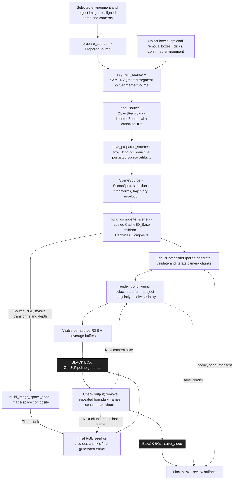
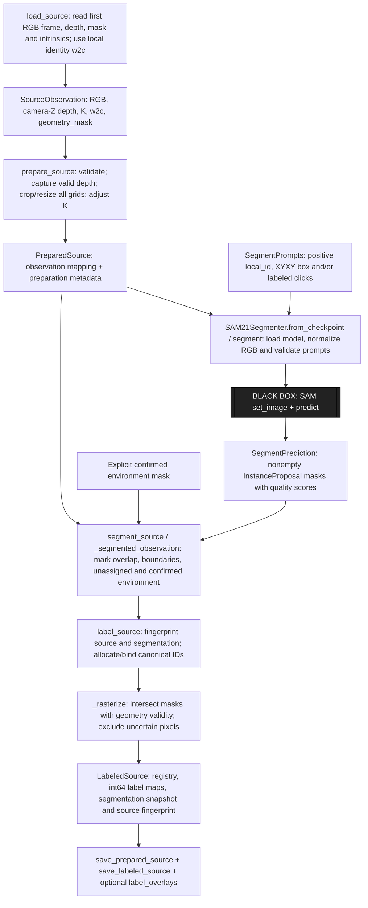
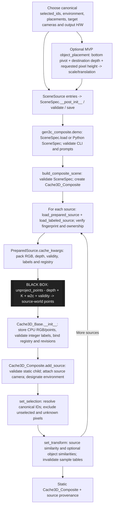
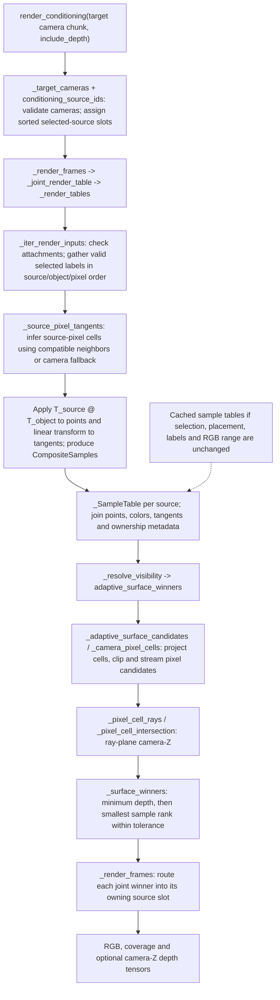
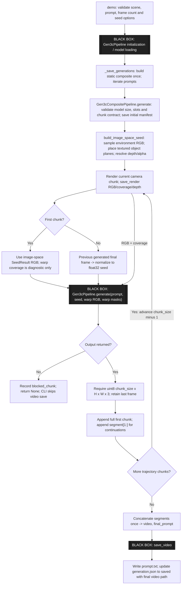

# Composite pipeline: images and bounding boxes to video

This traces the current composite implementation on `sandbox`, compared with
`main` at `ff53f0a` (`git diff main...HEAD`). New functions and changed functions
on the executed path are expanded. **BLACK BOX** means an unchanged repository
function or an external model API; its input/output contract is shown without
expanding its internals. A changed file does not make every function in it new.

Preparation and generation are separate operations. The generation CLI consumes
saved sources and a scene specification; it does not accept raw bounding boxes
or run segmentation. Composite GUI integration is proposed, not implemented.
The box-driven preparation entry point is
[`scripts/evaluate_real_cache_mvp.py`](../scripts/evaluate_real_cache_mvp.py).
Raw photographs alone are insufficient: each source also needs aligned depth,
validity, intrinsics, and an OpenCV world-to-camera matrix. The example loader
reads these from existing dataset artifacts; it does not estimate depth.

## 1. End-to-end overview

## 2. Images and boxes become labeled, reproducible sources

Repeat this stage independently for each source. The current composite builder
requires exactly one static observation per source.

`SourceObservation` and the segmentation/result classes are data containers.
`prepare_source()` optionally converts ray distance to camera-Z using unchanged
`unproject_points()`. RGB resize is bilinear; depth, validity, and categorical
labels use nearest sampling. Boxes/clicks must be expressed on the **prepared**
image grid, after any crop/resize. Each prompt group describes one object.

`SAM21Segmenter.segment()` uses the external predictor as a black box. When
multimask output is requested, it retains the highest-quality nonempty mask for
each group. Automatic proposal discovery is an alternative when prompts are
omitted; the box-driven path uses explicit groups. A SAM local ID or proposal
index is not a canonical object ID.

`ObjectRegistry.allocate()`, `bind_observation()`, and `resolve()` establish
source-scoped canonical identities. `label_source()` reuses explicit identity
links or existing bindings when supplied; otherwise it allocates IDs.
`_rasterize()` writes `-1` for unresolved, invalid, or ambiguous pixels; `0` for
confirmed valid environment; and positive canonical IDs for valid objects.
Mask overlaps remain unresolved rather than arbitrarily assigning an object.

In the MVP preparation driver, the caller confirms the environment with an
all-true mask. Environment removal boxes are segmented into positive IDs;
selecting only environment ID `0` later excludes those objects. Excluded regions
leave holes; preparation does not reconstruct the background behind them.

Persisted outputs are the exact prepared RGB/depth/K/w2c/validity NPZ and the
label artifact pair (`*_labels.json` and `*_labels.npz`). Optional overlays let
the author inspect canonical labels before proceeding.

## 3. Author the scene, then build static source caches

[`SceneSpec`](../cosmos_predict1/diffusion/inference/composite_scene.py)
stores artifact paths/fingerprints, selections, transforms, target cameras and
output size. `load()` resolves paths relative to the JSON; `save()` records
resolved paths. `validate()` checks unique source IDs, required environment ID
`0`, transforms, camera shapes, and OpenCV camera validity. The environment's
source transform stays identity. Loading never reruns depth estimation,
segmentation, or label resizing.

`build_composite_scene()` explicitly supplies unprojected points to the changed
`Cache3D_Base.__init__()`, avoiding the legacy depth clamp. The unchanged
`_compute_input_points()` is therefore bypassed on this path. The cache attaches
RGB, valid geometry, canonical labels, registry, fingerprint and segmentation
revision. Its original `render_cache()` is also bypassed: composition uses
`Cache3D_Composite` rendering.

Placement applies **destination point = T_source @ T_object @ source point**.
Similarities allow orientation-preserving uniform scale, rotation and
translation. Placement changes the gathered samples, not the child geometry.
The MVP helper computes a placement from destination base pixel, measured
environment depth and desired projected object height; direct callers may
provide matrices instead. `adjust_object_depth()` optionally scales object
position and size about the first camera to change depth while preserving its
initial projection.

## 4. Inside Cache3D_Composite rendering

The functions under
[`forward_warp_utils_pytorch.py`](../cosmos_predict1/diffusion/inference/forward_warp_utils_pytorch.py)
from `_point_pixel_coordinates()` through `adaptive_surface_winners()` are new
on this branch. They are expanded here; `unproject_points()` and
`project_points()` remain black boxes. The adaptive candidate path calls
unchanged `project_points()` to project cell centers/corners.

Pixel-cell tangents avoid bridging invalid pixels, different labels or large
depth discontinuities. Missing axes use a source-camera frontoparallel estimate.
Degenerate cells and near-plane-crossing cells fall back to point projection.
Candidates are streamed in bounded batches. Visibility compares **all selected
sources together**, so imported objects and the environment can occlude each
other. Ties resolve by deterministic source/object/original-pixel order within
the depth tolerance.

For `T` chunk frames and `N` selected source caches, outputs are:

| Output | Shape | Values / meaning |
| --- | --- | --- |
| `rgb` | `[1,T,N,3,H,W]` | Float32 `[-1,1]`; uncovered or hidden pixels are `-1` |
| `coverage` | `[1,T,N,1,H,W]` | Float32 binary visibility; hidden pixels are `0` |
| Optional `depth` | `[1,T,N,H,W]` | Winning pixel-cell camera-Z; holes are `0` |

`pixel_cell_winner_depth()` computes saved review depth at each winner's target
pixel. Source slots follow sorted source IDs. Several selected objects from one
source share a slot. Fully hidden or geometrically empty selected sources retain
their slot; sources without a selection are omitted. The wrapper rejects more
slots than the checkpoint's `frame_buffer_max`.

Related preview methods share the renderer: `render_cache()` calls `_render()`
for combined RGB or depth; `render_diagnostics()` additionally returns categorical
winner ownership and nearest depth. Generation uses `render_conditioning()`.
`combine_visible_buffers()` recombines the already resolved source buffers for
a joint preview or seed, without another projection/depth test.

`_source()` checks current attachments/label state; `refresh_source()` resolves
revised canonical IDs and invalidates tables. If merged objects have conflicting
placements, rendering requires an explicit `set_transform()` correction.
Label replacement and registry merging are editing paths, not normal generation
stages. Generated frames never update source caches.

## 5. Image-space seed, diffusion chunks, and final outputs

The unchanged `Gen3cPipeline.generate()` is a single black box here. Its contract
accepts the prompt, optional negative prompt, RGB seed `[1,3,1,H,W]`, and the
per-source warp RGB/coverage tensors. It returns `(uint8_video, final_prompt)`
or `None` on guardrail rejection. Its pretrained encoders, conditioning,
denoising, decoding and guardrails are not expanded. Review depth is not passed
to diffusion. The seed has no separate spatial coverage mask.

The first seed is produced directly by `build_image_space_seed()` using the
first scene camera: source environment RGB is sampled directly and
segmented object RGB is warped on transformed median-depth planes, with
per-pixel depth ordering and premultiplied alpha. `_maps()`, `_sample()`, and
`_result()` implement image mapping and the tensor contract.

There are no rendered/provided seed branches, seed-selection flags, or minimum
rendered-coverage threshold. The first camera must match the environment source
pose and have a covered field of view; moved environment objects are unsupported, while deselected objects are filled
with CPU LaMa.
Uncertain occlusions are rejected by default.
Unsupported scenes fail before diffusion rather than falling back to black holes.

Warp conditioning remains independent. The manifest records `seed_coverage=1.0`
for complete source RGB and `initial_warp_coverage` for diagnostic geometry
coverage; neither asserts trustworthy 3D geometry. Continuation chunks use the
previous generated final frame. `preview_composite_seed --compare-rendered` can
save a `cache_render_reference/` diagnostic, which is never used for generation.

Removed environment objects are inpainted on the source RGB grid, before the
image warp. The TorchScript adapter uses CPU PyTorch, preserves unmasked pixels,
and caches the repair by input/model hashes. Synthesized masks follow
interpolation and alpha compositing; synthetic RGB never enters the point cloud.
See [LaMa setup](LAMA_SEED_SETUP.md) for commands and diagnostics.
